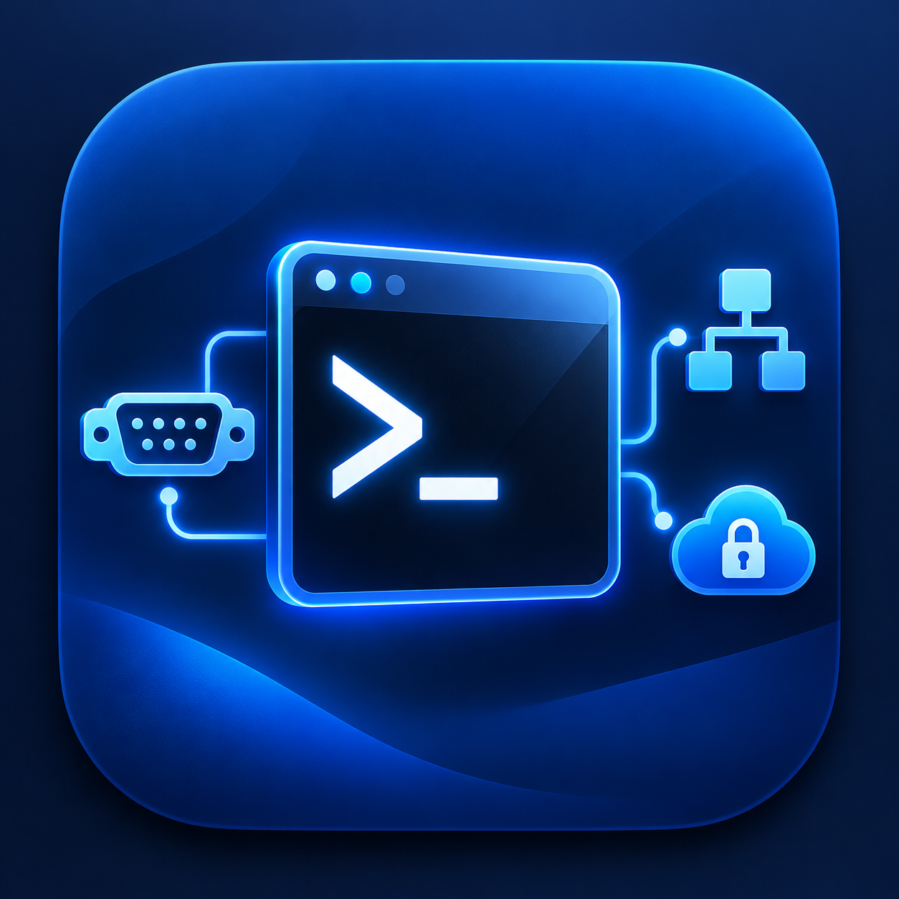

<p align="center">
  
</p>

<h1 align="center">Blue Serial</h1>

<p align="center">
  Seri cihazlarınızla iletişim kurmak için sade, açık kaynaklı bir Flutter uygulaması.
</p>

<p align="center">
  <a href="LICENSE"></a>
  
  
</p>

## Uygulama hakkında

**Blue Serial**, mikrodenetleyiciler, geliştirme kartları ve seri arayüz sunan cihazlarla veri alışverişi yapmanızı sağlar. Cihazınızın çıktısını takip edebilir, ASCII veya HEX komutlar gönderebilir ve sık kullandığınız komutları ayarlarıyla birlikte kaydedebilirsiniz.

Normal monitör görünümü veri trafiğini incelemek, terminal görünümü ise bağlı cihazın etkileşimli seri konsolunu kullanmak için tasarlanmıştır. Telefon, tablet ve masaüstü ekranlarına uyarlanan koyu arayüz, çalışma alanını veriye ayırır.

Bu depo iki parçadan oluşur:

- **`blue_serial/`**: Kullanıcı arayüzünü içeren Flutter uygulaması.
- **`blue_serial_lib`**: Uygulamanın kullandığı, başka Flutter projelerine de eklenebilen seri port kütüphanesi.

## Özellikler

| Özellik | Açıklama |
| --- | --- |
| Seri port bağlantısı | Portları listeleme, listeyi yenileme, baud hızı seçme ve bağlantıyı açıp kapatma. |
| İki çalışma görünümü | Normal veri monitörü ve xterm tabanlı terminal. |
| ASCII / HEX gönderimi | Metin komutları veya doğrudan onaltılık baytlar gönderme. |
| CR / LF kontrolü | Gönderilen komutun sonuna CR, LF veya CRLF ekleme. |
| Veri takibi | Gelen ve giden verileri ayrı renklerle; ASCII, HEX veya birlikte görüntüleme. |
| Trafik bilgileri | RX/TX bayt sayaçları, kayıt sayısı, otomatik takip ve ekranı temizleme. |
| Kayıtlı komutlar | Komut metnini, gönderim biçimini ve satır sonu ayarlarını birlikte saklama. |
| Komut yönetimi | Ayarlar sayfasından komut ekleme, düzenleme, silme ve listeyi yenileme. |
| Mobil klavye kontrolü | Normal monitörde klavyeyi yalnızca istediğinizde açıp kapatma. |
| Terminal kısayolları | Ctrl, Ctrl+C, Esc, Tab, Enter ve yön tuşları gibi özel tuşlara erişim. |
| Dil seçimi | Türkçe ve İngilizce arayüz; dil tercihinin saklanması. |
| Uyarlanabilir arayüz | Küçük ekranlarda kompakt bağlantı alanı ve ayrı bağlantı ayarları paneli. |

## Platform desteği

Aşağıdaki tablo depodaki mevcut seri port uygulamalarını gösterir. Bir platform klasörünün bulunması tek başına seri haberleşmenin desteklendiği anlamına gelmez.

| Platform | Durum | Bağlantı ve gereksinimler |
| --- | --- | --- |
| **Android** | Uygulandı | USB Host / OTG üzerinden USB seri cihazlar. Android 7.0 / API 24 ve üzeri, USB Host destekli cihaz ve uyumlu adaptör gerekir. |
| **Linux** | Uygulandı | Yerel seri portlar ve USB seri adaptörler. Kullanıcının ilgili `/dev/tty*` cihazına erişim izni olmalıdır. |
| **macOS** | Uygulandı | IOKit ile bulunan `/dev/cu.*` seri portları; erişim, sürücü ve uygulama izinlerine bağlıdır. |
| **Web** | Koşullu | Web Serial API sunan tarayıcı, HTTPS veya localhost ve kullanıcı tarafından verilmiş cihaz erişim izni gerekir. |
| **Windows** | Henüz uygulanmadı | Eklenti iskeleti ve üretilmiş bağlayıcılar mevcut; seri port işlemleri hazır değil. |
| **iOS** | Seri aktarım henüz uygulanmadı | API ve olay kanalları kayıtlıdır; port listesi boştur. Genel USB–seri adaptör desteği yoktur; MFi/BLE için cihaza özel bağlantı uygulaması gerekir. Simülatör Mac’in seri portlarını kullanamaz. |

Android tarafında cihaz tanıma ve USB seri haberleşmesi `usb-serial-for-android` sürücüsü üzerinden sağlanır. Görünen cihazlar bu sürücünün desteklediği seri arayüzlerle sınırlıdır. Web desteği de her tarayıcıda veya her mobil cihazda bulunmaz.

## Kullanım

### 1. Cihazınızı bağlayın

1. Seri cihazınızı bilgisayarınıza veya Android cihazınıza bağlayın. Android'de gerekiyorsa OTG adaptörü kullanın.
2. Uygulamayı açın ve port listesindeki **Yenile** seçeneğiyle cihazları tarayın.
3. **Port** alanından cihazınızı, **Baud** alanından cihazınızın kullandığı hızı seçin. Varsayılan hız **115200 baud** değeridir.
4. Bağlantı düğmesine basın. Android USB erişimi isterse izin verin.

Küçük ekranlarda bağlantı özetine dokunarak port ve baud ayarlarını açabilirsiniz. Haberleşme hızı cihazınızın ayarıyla aynı olmalıdır. Uygulama bağlantıları 8 veri biti, paritesiz ve 1 dur biti (**8N1**), akış kontrolü kapalı olarak açar.

**Web kullanıyorsanız:** Port alanındaki **+** düğmesine basıp tarayıcının cihaz seçme penceresinden izin verin. Listeyi yenilemek yalnızca siteye daha önce erişim izni verilmiş cihazları getirir.

### 2. Monitör görünümünü seçin

Görünüm değişikliğini bağlantı kapalıyken yapın:

- **Normal:** Gelen ve gönderilen baytları kayıtlar halinde takip edin. Gösterimi ASCII, HEX veya ikisi birlikte olacak şekilde ayarlayın. Otomatik takibi kapatarak eski kayıtları inceleyebilir, temizleme düğmesiyle görüntülenen trafiği silebilirsiniz.
- **Terminal:** Bağlı cihazın seri konsolunu kullanın. Terminal kontrol dizileri xterm tarafından işlenir; alt çubuktan özel tuşlar gönderebilirsiniz. Cihazın seri port üzerinden sunduğu konsolla iletişim kurulur.

Seri port bir bayt akışı taşır. Bir gönderim birden fazla okumaya bölünebilir; bir okuma da birden fazla mesaj içerebilir. USB okuma parçaları mesaj sınırı değildir. Mesajları doğru ayırmak için cihaz protokolünün tanımladığı ayraç veya uzunluk bilgisi gerekir.

### 3. Komut gönderin

Normal monitörün altındaki metin alanını kullanın:

1. Alan boşken **ASCII / HEX** düğmesine basarak gönderim biçimini seçin.
2. Cihazınız satır sonu bekliyorsa **CR** ve **LF** düğmelerini ayarlayın.
3. Komutunuzu yazın ve **Gönder** simgesine basın. Göndermek için açık bir bağlantı gerekir.

Metin yazıldığında biçim ve satır sonu düğmeleri yer açmak için gizlenir; seçili ayarlar korunur ve alanın etiketinde görünür. Alan boşaldığında düğmeler yeniden görünür. Başarılı gönderimin ardından metin alanı temizlenir.

Mobil cihazlarda metin alanına dokunmak klavyeyi kendiliğinden açmaz. Alanın başındaki **klavye** simgesiyle açıp kapatabilirsiniz.

| Gönderim | Yazılacak değer | CR | LF | Gönderilen baytlar |
| --- | --- | --- | --- | --- |
| ASCII | `AT` | Açık | Açık | `41 54 0D 0A` |
| HEX | `41 54` | Kapalı | Kapalı | `41 54` |
| HEX | `01 03 00 00` | Kapalı | Kapalı | `01 03 00 00` |

ASCII modu 0–127 aralığındaki karakterleri kabul eder. HEX modunda her bayt iki onaltılık haneden oluşur; `0A`, `FF` veya `41 42 0D 0A` gibi değerler yazabilirsiniz. CR, `0D`; LF, `0A` baytını verinin sonuna ekler. Bunları HEX metnine zaten yazdıysanız düğmelerden tekrar eklemeyin.

### 4. Komutlarınızı kaydedin ve yeniden kullanın

- Metin alanına bir komut yazıldığında **Kaydet** simgesi görünür. Basıldığında komut, ASCII/HEX ve CR/LF ayarlarıyla birlikte kaydedilir; adı metinden otomatik oluşturulur.
- Alan boşken **kayıtlı komutlar** simgesine (büyüteç) basın. Açılan listeden seçtiğiniz komut, metni ve gönderim ayarlarıyla birlikte alana yüklenir. Göndermek için ayrıca **Gönder** düğmesine basın.
- **Ayarlar → Kayıtlı komutlar** alanında **+** ile adlandırılmış yeni bir komut oluşturabilir, mevcut komutları düzenleyebilir veya silebilirsiniz. Dar ekranlarda düzenleme ve silme işlemleri kartın üç nokta menüsündedir.

Kayıtlı komutlar cihazda, Web sürümünde ise tarayıcının uygulama depolamasında saklanır. Uygulama veya site verilerini temizlemek bu kayıtları kaldırabilir. Trafik geçmişi oturum sırasında bellekte tutulur; kalıcı günlük dosyası olarak kaydedilmez.

### 5. Ayarları açın

Monitör başlığındaki **ayarlar** simgesinden:

- Arayüz dilini Türkçe veya İngilizce olarak seçebilirsiniz.
- Kayıtlı komutlarınızı yönetebilirsiniz.
- **Hakkında** bölümünde açık kaynak ve MIT lisansı bilgisini, proje adresini görebilirsiniz.

## Kaynak koddan çalıştırma

Flutter SDK, proje tarafından istenen **Dart 3.12.2 veya uyumlu daha yeni bir 3.x sürümü** ve hedef platformun geliştirme araçları gerekir. Android eklentisi Java 17 ve Android SDK 36 ile yapılandırılmıştır.

```sh
git clone https://github.com/ysfgrl/blue_serial_lib.git
cd blue_serial_lib
flutter pub get
cd blue_serial
flutter pub get
```

Ardından hedefinize göre bir komut seçin:

```sh
# Linux
flutter run -d linux

# macOS
flutter run -d macos

# Web
flutter run -d chrome

# Android: bağlı cihazları listeleyip cihaz kimliğini kullanın
flutter devices
flutter run -d CIHAZ_KIMLIGI
```

Komutları `blue_serial/` dizininden çalıştırın. `CIHAZ_KIMLIGI` yerine `flutter devices` çıktısındaki Android cihaz kimliğini yazın. Android cihazın USB hata ayıklaması etkin olmalıdır; gerçek USB seri haberleşmesi için USB Host destekli fiziksel cihaz kullanın. Yerel eklenti kodu değişikliklerinin yüklenmesi için uygulamayı tamamen durdurup yeniden başlatın.

## Sık karşılaşılan durumlar

| Durum | Kontrol edin |
| --- | --- |
| Port listesi boş | Cihazın veri kablosuyla bağlı olduğunu, adaptörü ve sürücüyü kontrol edin; listeyi yenileyin. Android'de USB Host / OTG desteği gerekir. |
| Linux'ta erişim reddediliyor | Seri portun izinlerini ve kullanıcınızın ilgili cihaz grubuna erişimini kontrol edin. Grup adı dağıtıma göre değişebilir. |
| Port meşgul | Aynı portu kullanan başka terminal veya geliştirme aracını kapatın. |
| Yanlış karakterler geliyor | Cihazın baud hızını ve 8N1 seri bağlantı ayarlarını karşılaştırın; ham baytları HEX görünümünde inceleyin. |
| Komut gönderiliyor ama yanıt yok | Cihazın beklediği komut biçimini ve CR/LF gereksinimini kontrol edin. |
| Web'de cihaz seçilemiyor | Web Serial desteğini, HTTPS / localhost kullanımını ve tarayıcı izinlerini kontrol edin. |
| Cihaz çıkarıldıktan sonra bağlantı kapandı | Cihazı yeniden bağlayın, portları yenileyin ve bağlantıyı tekrar açın. |

## Geliştiriciler için

Uygulama Flutter, Material 3, `flutter_bloc`, `easy_localization`, `shared_preferences` ve `xterm` kullanır. Yerel seri port katmanı Pigeon üzerinden, Web katmanı tarayıcının Web Serial API'si üzerinden çalışır.

```text
blue_serial_lib/
├── blue_serial/        # Flutter uygulaması
│   └── lib/src/
│       ├── serial/    # Monitör, bağlantı ve gönderim arayüzü
│       ├── term/      # Terminal görünümü ve klavye kontrolleri
│       ├── setting/   # Ayarlar ve komut yönetimi
│       ├── helper/    # Ortak widget'lar ve veri yardımcıları
│       ├── models/    # Uygulama veri modelleri
│       ├── store/     # Yerel kayıtlar
│       └── bloc/      # Bağlantı ve trafik durumu
├── lib/                # Kütüphanenin Dart API'si ve Web uygulaması
├── android/            # Android USB seri uygulaması
├── linux/              # Linux seri port uygulaması
├── macos/              # macOS seri port uygulaması
├── ios/                # iOS API kaydı; seri aktarım henüz yok
├── windows/            # Windows iskeleti; seri port desteği henüz yok
├── pigeon/             # Platform API tanımları
└── docs/               # Teknik belgeler
```

Kütüphaneyi başka bir projede kullanmak, bağlantı ve veri akışlarını öğrenmek, Android depo ayarlarını yapmak veya platform bağlayıcılarını üretmek için **[Seri Port API ve Platform Notları](docs/serial-api.md)** belgesine bakın. Kütüphane birden fazla port bağlantısı sunar; uygulama arayüzü aynı anda seçili tek bağlantıyı yönetir.

## Katkıda bulunun

Hata bildirimleri, arayüz önerileri ve yeni platform uygulamaları için katkılarınızı bekliyoruz.

- [Issue açın](https://github.com/ysfgrl/blue_serial_lib/issues): Platformu, cihaz / adaptör modelini, baud hızını ve sorunu yeniden oluşturma adımlarını paylaşın.
- [Pull request gönderin](https://github.com/ysfgrl/blue_serial_lib/pulls): Değişikliğin amacını ve hangi platformda denediğinizi açıklayın.
- Projeyi faydalı bulduysanız GitHub'da yıldız vererek destek olabilirsiniz.

## Gizlilik

Google Play ve App Store sürümleri için Türkçe ve İngilizce [Gizlilik Politikası](PRIVACY_POLICY.md) mevcuttur. Politika; seri cihaz erişimini, yerel kayıtları, günlük dışa aktarmayı ve verilerin silinmesini açıklar. Mağaza gizlilik alanlarını doldurmak ve politika adresini yayımlamak için [Mağaza gizlilik beyanları](docs/store-privacy.md) belgesine bakın.

## Lisans

Bu proje **[MIT Lisansı](LICENSE)** ile açık kaynak olarak sunulur. Lisans koşullarını ve telif bildirimini koruyarak kullanabilir, değiştirebilir ve paylaşabilirsiniz. Kullanılan üçüncü taraf bileşenler kendi lisanslarına tabidir; Ubuntu Mono yazı tipinin lisansı [burada](blue_serial/assets/fonts/ubuntu_mono/LICENSE.txt) yer alır.

<p align="center">
  Merakla geliştirildi, herkesle paylaşıldı.<br />
  <strong>ysfgr © 2026</strong><br />
  <a href="https://github.com/ysfgrl/blue_serial_lib">github.com/ysfgrl/blue_serial_lib</a>
</p>
